<p align="center">
  
</p>

<p align="center">
  <a href="https://yigitozc.github.io"></a>
  <a href="https://www.linkedin.com/in/yi%C4%9Fit-%C3%B6z%C3%A7elik-386645382"></a>
  <a href="mailto:yigitozcelik88@gmail.com"></a>
</p>

<p align="center">
  🇬🇧 English · <a href="#-türkçe">🇹🇷 Türkçe</a>
</p>

## 👋 About me

I am a second-year **Computer Engineering** student at **Ankara University**, working on **autonomous ground vehicles** and the software that lets perception, localization and planning run together on a real platform. What interests me most is the engineering that makes these systems dependable: clear interfaces between modules, repeatable tests and simulations that reflect the field. I also build web applications and take an active part in student communities at my university.

```python
class Yigit:
    location  = "Ankara, Türkiye"
    studying  = "Computer Engineering @ Ankara University"
    focus     = ["autonomous ground vehicles", "robot simulation", "web applications"]
    languages = {"Turkish": "native", "English": "limited working", "Japanese": "elementary"}
```

## 🎓 Education

| | |
|---|---|
|  | **Ankara University**: B.Sc. Computer Engineering |

## 🏁 Competitions

**TEKNOFEST 2026 Robotaxi Passenger Autonomous Vehicle Competition**<br>
*Ready-made vehicle category · Team AUtomotion-R · Finalist*

An end-to-end autonomy stack for the BEE1 passenger vehicle, built for static and dynamic traffic scenarios on a closed track. The source code is private.

| | |
|---|---|
| **My role** | Started on the autonomous bus-stop manoeuvre (stop sign detection, entering the bay, IMU-confirmed full stop, rejoining the lane), later grew to cover the architecture of the whole system |
| **Perception** | Lane detection with a CLRerNet model fine-tuned on track data, traffic sign and light detection with YOLO, Velodyne lidar processing per zone around the vehicle |
| **Localization** | Map-frame pose from an Xsens MTi GNSS/INS unit, supported by wheel odometry |
| **Planning** | A* routing between map zones, Lanelet2 centre-line following, behaviour tree for overtaking and parking |
| **Control** | Lane following and overtaking controller, the only node writing to the vehicle's CAN bus |
| **Deployment** | ROS 2 Foxy in a single GPU Docker image, with a simulation bridge and per-day scenario tests |

## 🚀 Projects

<table>
<tr>
<td width="50%" valign="top">

### 🧰 [MTA Workshop Inventory](https://github.com/yigitozc/mta-atolye-takip)
Inventory and request system for the National Technology Workshop. Students request parts, and coordinators approve and hand them out. 


</td>
<td width="50%" valign="top">

### 🗺️ [Portfolio site](https://github.com/yigitozc/yigitozc.github.io)
My personal site at [yigitozc.github.io](https://yigitozc.github.io). Its simulation implements frontier-based exploration: lidar ray casting, an occupancy grid, A* replanning and path tracking, with no libraries.


</td>
</tr>
</table>

**Other projects** (source code not public)

- **HTAB İKA Simulation**: Gazebo and RViz test field for the unmanned ground vehicle stage of TEKNOFEST Advanced Autonomous Systems
- **Edge AI Perception Pod**: HackAntarktika project, an edge AI perception module for polar field conditions
- **MTA Management Platform**: team project with a separate frontend, API gateway and Java backend
- **Mola Boutique Café**: framework-free café website with a JSON-driven menu and occupancy status
- **UGV 3D Model**: compact Blender model with suspension and laser animations

## 🛠️ Tech stack

| | |
|---|---|
| **Languages** |  |
| **Robotics & simulation** |      |
| **Tools** |  |

## 🌍 Languages

| Language | Level |
|---|---|
| 🇹🇷 Turkish | Native |
| 🇬🇧 English | Limited working proficiency |
| 🇯🇵 Japanese | Elementary proficiency |

## 📜 Certifications

- **Programming with Python**: MATHCOM · Ankara University · *Nov 2025*

## 🤝 Active communities

- **CORE Student Community**, Ankara University · Board Member · *2025 – present*
- **AUtomotion-R**, autonomous vehicle team
- **National Technology Workshop (MTA)**, Ankara University

## 📡 Activity

<p align="center">
  
</p>

---

## 🇹🇷 Türkçe

<details>
<summary><b>Türkçe özet için tıkla</b></summary>

<br>

Ankara Üniversitesi Bilgisayar Mühendisliği ikinci sınıf öğrencisiyim. Otonom kara araçları ve algı, konumlama ve planlama katmanlarının gerçek bir araç üzerinde birlikte çalışmasını sağlayan yazılımlar üzerine çalışıyorum. Bu sistemlerde beni en çok, onları güvenilir kılan mühendislik ilgilendiriyor: modüller arasında net arayüzler, tekrarlanabilir testler ve sahayı doğru yansıtan simülasyonlar. Bunun yanında web uygulamaları geliştiriyor, üniversitemdeki öğrenci topluluklarında aktif olarak yer alıyorum.

**Eğitim:** Ankara Üniversitesi, Bilgisayar Mühendisliği (2025 → devam ediyor)

**Katıldığım yarışmalar**
- **TEKNOFEST 2026 Robotaksi Binek Otonom Araç Yarışması** (hazır araç kategorisi, AUtomotion-R, finalist): BEE1 binek aracı için uçtan uca otonom sürüş yazılımı. CLRerNet ile şerit algılama, YOLO ile trafik işareti ve ışık tespiti, Velodyne LiDAR ile engel algılama, Xsens MTi GNSS/INS ile konumlama, Lanelet2 ve davranış ağacı ile planlama; ROS 2 Foxy ve Docker. İşe otonom durak manevrasıyla başladım, sonrasında sistemin tüm mimarisine hâkim oldum. Kaynak kodu paylaşılmıyor.

**Projeler**
- **[MTA Atölye Malzeme Takip Sistemi](https://github.com/yigitozc/mta-atolye-takip)**: öğrencilerin malzeme talep ettiği, koordinatörlerin onaylayıp teslim ettiği web uygulaması
- **[Portfolyo sitesi](https://yigitozc.github.io)**: sınır tabanlı keşif simülasyonu içeren kişisel sitem: LiDAR ışın izleme, doluluk ızgarası, A* ile yeniden planlama

**Diğer projeler** (kaynak kodu paylaşılmıyor)
- **HTAB İKA Simülasyonu**: TEKNOFEST İleri Otonom Sistemler İKA aşaması için Gazebo ve RViz test sahası
- **Edge AI Otonom Algı Podu**: HackAntarktika projesi; kutup saha koşulları için uç yapay zekâ tabanlı algı modülü
- **MTA Yönetim Platformu**: ayrı frontend, API gateway ve Java backend içeren takım projesi
- **Mola Butik Kafe**: JSON'dan beslenen menü ve doluluk durumuna sahip, framework'süz kafe sitesi
- **İKA 3D Modeli**: süspansiyon ve lazer animasyonlu kompakt Blender modeli

**Diller:** Türkçe (ana dil) · İngilizce (sınırlı mesleki yeterlilik) · Japonca (başlangıç)

**Sertifikalar:** MATHCOM Python ile Programlama Eğitimi, Ankara Üniversitesi (Kasım 2025)

**Aktif olarak görev aldığım topluluklar**
- **CORE Öğrenci Topluluğu**, Ankara Üniversitesi: Yönetim Kurulu Üyesi (2025 – devam ediyor)
- **AUtomotion-R**, otonom araç takımı
- **Milli Teknoloji Atölyesi (MTA)**, Ankara Üniversitesi

📫 Bana [LinkedIn](https://www.linkedin.com/in/yi%C4%9Fit-%C3%B6z%C3%A7elik-386645382) veya [e-posta](mailto:yigitozcelik88@gmail.com) ile ulaşabilirsin.

</details>
